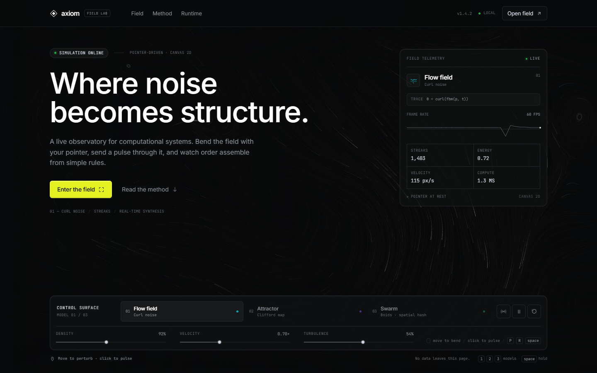
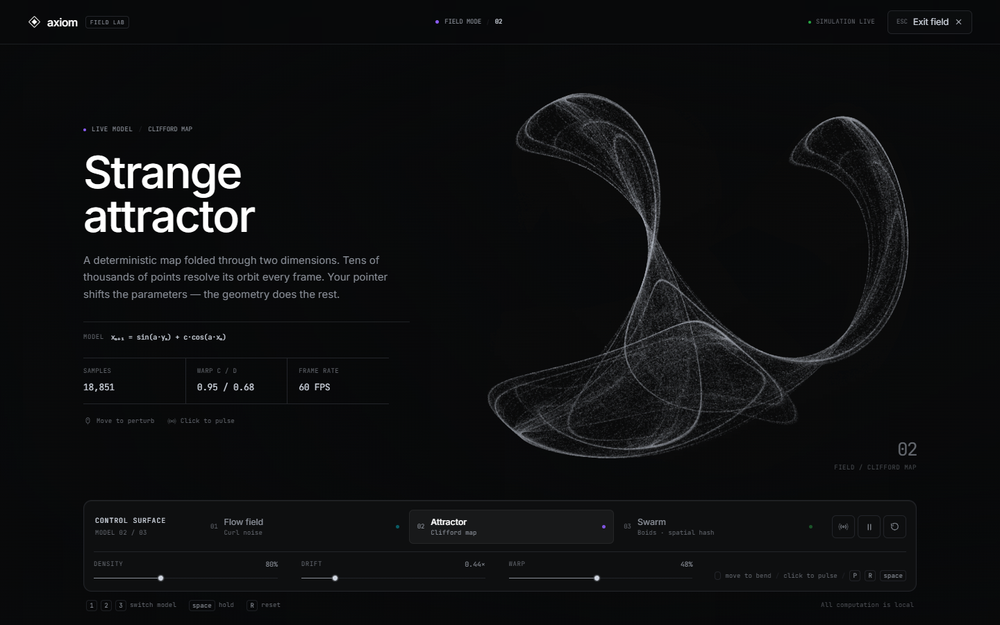

# Axiom · 交互式算法场实验室

一个基于 Vue 3 + TypeScript + Canvas 2D 的前端 Demo。视觉语言参考 `DESIGN.md` 中 Linear 的 “midnight precision instrument”：近黑画布、纸白正文、单一点缀的酸性柠檬绿主操作、发丝级描边，以及 Inter / JetBrains Mono 的技术感排版。

页面把三套实时算法做成可交互背景与独立的全屏实验场：移动指针可以扰动系统，点击会注入一次脉冲，右侧控制台能实时换模型并调整参数。





## 快速开始

```bash
npm install
npm run dev
```

打开终端中 Vite 输出的地址（默认 `http://127.0.0.1:5173`）。

```bash
npm run typecheck   # vue-tsc --noEmit
npm run build       # 生产构建
npm run preview     # 预览构建产物
```

## 交互方式

- **移动指针**：扰动当前算法场；不同模型有不同响应方式。
- **点击空白背景**：发送一个扩散脉冲。点击标题、卡片或面板本身不会误触。
- **进入 / 退出全屏实验场**：点击 `Enter the field` 或右上角 `Open field`；按 `Esc` 或 `Exit field` 返回。
- **切换模型**：控制台中的 `Flow field / Attractor / Swarm`，或按 `1` `2` `3`。
- **调整参数**：拖动 `DENSITY / VELOCITY / TURBULENCE`（不同模型下会换成对应语义，如 `DRIFT` `WARP` `COHESION`）。
- **其它快捷键**：`Space` 暂停 / 继续，`P` 发送脉冲，`R` 重置当前模型。
- **Method 区块**：选择任一模型查看运行时说明、算法公式与源码片段，并可直接 `Copy`；`Open in field` 会带着当前模型进入全屏实验场。

## 三套算法

### 01 · Flow field / 卷曲噪声场

`src/lib/simulations/flow.ts`

- 生成一个由分形值噪声构成、经过 curl 处理的二维速度场。
- 粒子在速度场景中做半隐式 Euler 积分，留下逐渐消散的轨迹。
- 指针附近加入切向涡旋与轻微吸引；点击脉冲会以环形波的方式推开粒子。
- 指标：`ENERGY`（归一化平均速率）、`VELOCITY`（平均速度）。

### 02 · Strange attractor / Clifford 奇怪吸引子

`src/lib/simulations/attractor.ts`

- 迭代 Clifford map：

  ```text
  x' = sin(a·y) + c·cos(a·x)
  y' = sin(b·x) + d·cos(b·y)
  ```

- 每帧采样数万点，投影为缓慢旋转的正交视图；轨迹以点云密度呈现。
- 使用长曝光式帧间累积：单帧稀疏的点云在数帧叠加后形成连续的丝状结构。
- 指针会平滑地扭曲 `c / d` 参数，点击会让几何暂时共振。
- 指标：`WARP C / D`、`ORBIT A / B`。

### 03 · Collective motion / Reynolds Boids

`src/lib/simulations/swarm.ts`

- 每个 boid 计算 alignment、cohesion、separation 三项局部转向力。
- 通过空间哈希将邻居搜索限制在 3×3 个 100px 网格单元中，避免全量两两遍历。
- 指针作为柔和排斥源；点击脉冲会短暂打散队形。软性径向边界与画布边缘共同保证群落在画面内巡游。
- 指标：`POLARIZATION`（速度一致性）、`NEIGHBOURS`（平均邻居数）。

## 实现细节

- **Vue 3 Composition API + TypeScript strict + Vite 7**，无 UI 框架依赖。
- **渲染**：原生 Canvas 2D；`FieldEngine` 统一负责尺寸、DPR、指针、脉冲、统计与 60fps 节流。
- **性能**：
  - DPR 上限 1.5，避免高分辨率屏幕上的无谓填充。
  - 渲染循环上限 60fps，并做逐帧成本统计。
  - 当 Hero 滚出视口后自动停止背景模拟；回到顶部后恢复。
  - `visibilitychange` 时自动暂停。
  - 页面使用 `prefers-reduced-motion`：关闭 CSS 入场动效，并降低算法运动幅度。
- **可访问性**：
  - 所有控件具备可读标签 / `aria-pressed` / 可见焦点环。
  - 全屏实验场使用 `role="dialog"`、`aria-modal`、焦点捕获、`inert` 背景和焦点返回。
  - 打开全屏模式时锁定页面滚动；`Esc` 始终可退出。
- **无外部资源请求**：Inter Variable 与 JetBrains Mono 通过 npm 字体包本地加载，所有计算在浏览器内完成。

## 目录结构

```text
.
├── DESIGN.md                    # 原始视觉参考
├── src/
│   ├── App.vue                  # 页面编排、键盘交互、全屏状态
│   ├── components/
│   │   ├── FieldBackground.vue  # Canvas 宿主与指针事件
│   │   ├── SiteHeader.vue
│   │   ├── EngineReadout.vue    # 实时遥测卡
│   │   ├── ControlDeck.vue      # 模型 / 参数 / 播放控制
│   │   ├── FocusOverlay.vue     # 全屏实验场
│   │   ├── MethodSection.vue    # 模型索引 + 运行时源码
│   │   ├── CodaSection.vue
│   │   └── SiteFooter.vue
│   ├── lib/
│   │   ├── fieldEngine.ts       # RAF、DPR、统计、脉冲、节流
│   │   ├── noise.ts             # 3D value noise / fBm / PRNG
│   │   └── simulations/         # flow / attractor / swarm
│   ├── data/algorithms.ts       # 模型文案、公式、代码片段
│   └── styles/                  # tokens 与全局样式
└── ...
```

## 设计注记

- 整个页面只有一个高强调操作使用 `#e4f222`：Hero 的 `Enter the field`。
- 支持的色彩只以小圆点 / 模型标记出现，不进入背景艺术或正文。
- 界面主要依靠 1px 发丝线、内阴影和 0.5 级明度差建立层次，不使用大投影。
- 卡片圆角 12px、控件圆角 6px、pill 为全圆角；字重保持在 400–590 之间。
- `Axiom` 品牌、文案与所有界面数据均为本 Demo 虚构内容。
